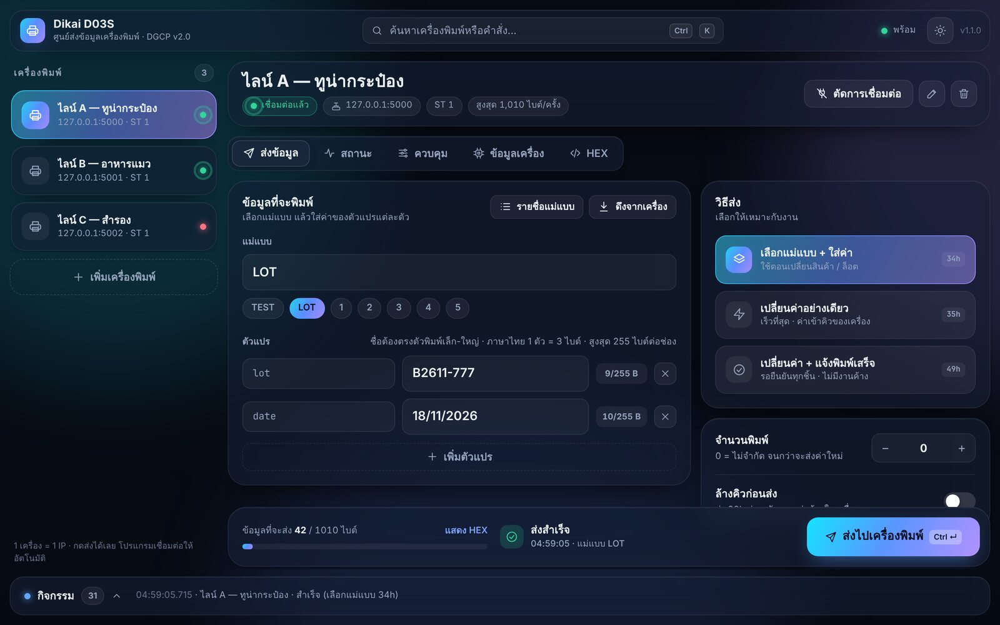
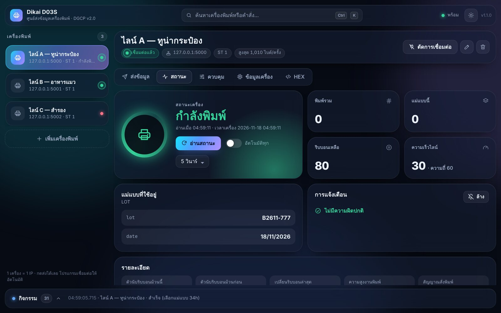
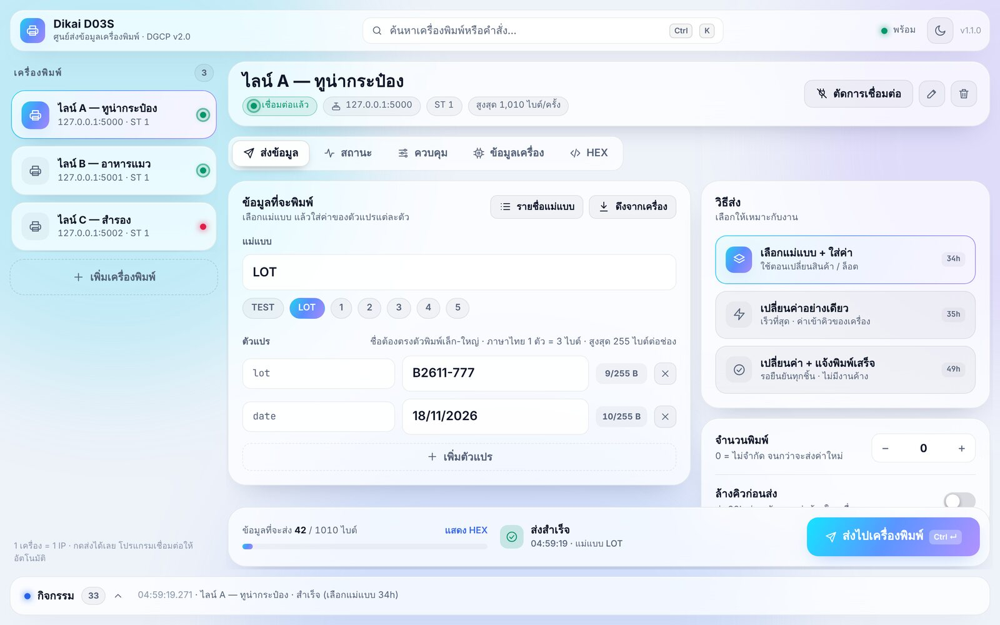

# Dikai D03S — โปรแกรมส่งข้อมูลเครื่องพิมพ์ (Windows)

โปรแกรม Windows สำหรับส่งข้อความ เช่น ล็อต วันที่ หรือรหัสสินค้า ไปยังเครื่องพิมพ์ Dikai D03S (TTO / Thermal Transfer Overprinter)
ผ่าน **LAN (TCP/IP)** หรือ **RS232 (COM)** โดยใช้โปรโตคอล **DGCP v2.0** ตามเอกสารของผู้ผลิต
คอมพิวเตอร์เครื่องเดียวคุมเครื่องพิมพ์ได้หลายเครื่อง แต่ละเครื่องแยกกันด้วย IP



- ไฟล์โปรแกรม: [`dist/DikaiD03S.exe`](dist/DikaiD03S.exe) ไฟล์เดียว
- ใช้ได้กับ Windows 10 / 11 ซึ่งมี .NET Framework 4.8 และ Microsoft Edge อยู่แล้ว **ไม่ต้องติดตั้งอะไรเพิ่ม**
- โปรแกรมจำลองเครื่องพิมพ์สำหรับทดลองโดยไม่มีเครื่องจริง: [`dist/PrinterSimulator.exe`](dist/PrinterSimulator.exe)

> ตอนเปิดครั้งแรก Windows อาจขึ้น "Windows protected your PC" เพราะไฟล์ไม่ได้เซ็นชื่อดิจิทัล
> ให้กด **More info → Run anyway** หรือคลิกขวาที่ไฟล์ → Properties → ติ๊ก **Unblock**

### หน้าตาโปรแกรม (v1.1)

หน้าจอทำด้วย HTML/CSS ฝังอยู่ใน exe และเปิดเป็น **หน้าต่างแอปของ Microsoft Edge** (ไม่มีแถบที่อยู่และแท็บ) จึงดูเหมือนโปรแกรมทั่วไป

- ธีมมืด/สว่าง (ปุ่ม ☀/🌙 มุมขวาบน), การ์ดแบบกระจก, เลย์เอาต์แบบ bento, มี animation
- **Ctrl + K** ค้นหาเครื่องพิมพ์หรือคำสั่ง · **Ctrl + Enter** ส่งข้อมูล · **Alt + 1–5** สลับหน้า
- แถบ **กิจกรรม** ด้านล่างแสดงทุกคำสั่งที่ส่ง/รับพร้อม HEX กดเพื่อขยาย กรองดูเฉพาะส่ง/รับ/ผิดพลาดได้
- ไอคอนของโปรแกรมอยู่ที่ system tray (มุมขวาล่างของ Windows): ดับเบิลคลิกเพื่อเปิดหน้าต่างอีกครั้ง หรือคลิกขวาเพื่อออกจากโปรแกรม
- ปิดหน้าต่างแล้ว โปรแกรมปิดตามเองภายในไม่กี่วินาที ถ้าเปิด exe ซ้ำขณะโปรแกรมทำงานอยู่ จะได้หน้าต่างของโปรแกรมเดิม (ไม่เปิดซ้อนสองตัว)
- ถ้าเครื่องไม่มี Edge โปรแกรมจะเปิดด้วยเบราว์เซอร์เริ่มต้นแทน

| สถานะเครื่อง | ธีมสว่าง |
|---|---|
|  |  |

---

## เริ่มใช้งาน

1. **ตั้ง IP ที่หน้าจอเครื่องพิมพ์ทุกเครื่องให้ไม่ซ้ำกัน**
   ค่าจากโรงงานคือ `192.168.1.2` port `5000` เหมือนกันทุกเครื่อง ถ้าไม่เปลี่ยนจะชนกัน
   คอมพิวเตอร์ต้องอยู่วงแลนเดียวกับเครื่องพิมพ์ (เช่น `192.168.1.x`)
2. เปิด `DikaiD03S.exe` แล้วกด **เพิ่มเครื่องพิมพ์** ใส่ชื่อ, IP, port `5000` และเลขเครื่อง (ST)
3. หน้า **ส่งข้อมูล**
   - กด **ดึงจากเครื่อง** เพื่ออ่านชื่อแม่แบบที่ใช้อยู่และชื่อตัวแปร หรือกด **รายชื่อแม่แบบ** แล้วแตะชื่อแม่แบบที่ต้องการ
   - แก้ค่าในช่องของแต่ละตัวแปร
   - เลือกวิธีส่ง แล้วกด **ส่งไปเครื่องพิมพ์** (โปรแกรมเชื่อมต่อให้อัตโนมัติ)
4. ผลการส่งแสดงข้างปุ่มส่ง ส่วนรายละเอียดทุกคำสั่งดูได้ในแถบ **กิจกรรม** ด้านล่าง

### วิธีส่ง 3 แบบ

| วิธีส่ง | คำสั่ง | ใช้เมื่อ |
|---|---|---|
| เลือกแม่แบบ + ใส่ค่า | `34h` | เปลี่ยนสินค้าหรือล็อต ต้องระบุชื่อแม่แบบ |
| เปลี่ยนค่าอย่างเดียว | `35h` | ใช้แม่แบบเดิม เร็วที่สุด ค่าเข้าคิวของเครื่อง ถ้าคิวเต็มเครื่องตอบ error 08 |
| เปลี่ยนค่า + แจ้งเมื่อพิมพ์เสร็จ | `49h` | เครื่องตอบ `4Ah` เมื่อพิมพ์เสร็จจริง ไม่มีงานค้างหรือพิมพ์เสียเปล่า โปรแกรมขึ้น "พิมพ์เสร็จแล้ว" |

- **จำนวนพิมพ์** `0` หมายถึงพิมพ์ไม่จำกัด จนกว่าจะส่งค่าใหม่ ถ้าใส่ `n` จะพิมพ์ n ครั้ง
- **ล้างคิวก่อนส่ง (38h)** ใช้ตามรูปแบบในเอกสาร (ตัวอย่าง 6) เมื่อไม่ต้องการให้งานเก่าค้างในคิว
- ชื่อตัวแปร **ต้องตรงตัวพิมพ์เล็ก-ใหญ่** ส่วนชื่อแม่แบบไม่สนตัวพิมพ์
- ค่าแต่ละช่องยาวได้ไม่เกิน 255 ไบต์ (ภาษาไทย 1 ตัวอักษร = 3 ไบต์ หรือประมาณ 85 ตัว)
  และทั้งแพ็กเก็ตต้องไม่เกิน 1,010 ไบต์ทาง LAN หรือ 256 ไบต์ทาง RS232 โปรแกรมแสดงขนาดให้ก่อนส่ง

### แท็บอื่นๆ

| แท็บ | ทำอะไร |
|---|---|
| สถานะ | อ่านสถานะเครื่อง (3Ah) ทั้งแบบกดเองและอัตโนมัติ: กำลังพิมพ์/ว่าง/ผิดพลาด, แม่แบบและค่าที่ใช้อยู่, ตัวนับ, ริบบอน, รายการแจ้งเตือน |
| ควบคุม | เริ่ม/หยุด, ทดสอบพิมพ์, สั่งพิมพ์จากโปรแกรม (4Bh), ล้างคิว/แจ้งเตือน/ตัวนับ, อ่านเวลา และตั้งเวลาเครื่องตามคอมพิวเตอร์ |
| ข้อมูลเครื่อง | อ่านค่าเครื่องทั้งหมด (40h) เช่น IP, เลขเครื่อง, ชนิดริบบอน และรายชื่อไฟล์ใน USB (A0h) |
| HEX (ขั้นสูง) | ส่งคำสั่งเองเป็น HEX สำหรับตรวจปัญหา |

### ไฟล์ที่โปรแกรมสร้าง

เก็บไว้ข้างไฟล์ exe ถ้าโฟลเดอร์นั้นเขียนไม่ได้ (เช่น Program Files) จะเก็บที่ `%LOCALAPPDATA%\DikaiD03S` แทน

- `DikaiD03S.settings.json`: รายชื่อเครื่อง และแม่แบบ/ค่าล่าสุดของแต่ละเครื่อง (copy ไปใช้เครื่องอื่นได้)
- `logs\yyyy-MM-dd.log`: บันทึกทุกคำสั่งที่ส่ง/รับพร้อม HEX เก็บไว้ 60 วัน
- `%LOCALAPPDATA%\DikaiD03S\app-window`: โปรไฟล์ของหน้าต่าง Edge ที่แยกจาก Edge ที่ผู้ใช้เปิดตามปกติ

### ความปลอดภัย

หน้าจอคุยกับตัวโปรแกรมผ่าน `http://127.0.0.1` (ภายในเครื่องเท่านั้น เครื่องอื่นในแลนเข้าไม่ได้) ด้วยพอร์ตแบบสุ่ม
ทุกคำสั่งต้องแนบ token ที่สุ่มใหม่ทุกครั้งที่เปิดโปรแกรม และโปรแกรมตรวจ Host/Origin ด้วย
เว็บไซต์อื่นที่เปิดในเบราว์เซอร์เครื่องเดียวกันจึงสั่งเครื่องพิมพ์ไม่ได้

---

## ทดลองโดยไม่มีเครื่องพิมพ์

```bat
PrinterSimulator.exe
```

จะได้เครื่องพิมพ์จำลองที่ `127.0.0.1:5000` (ST = 1) มีแม่แบบ `TEST` (ตัวแปร `text1`), `LOT` (`lot`, `date`) และ `1`–`5`
จากนั้นในโปรแกรมให้เพิ่มเครื่อง IP `127.0.0.1` แล้วลองส่งได้เลย

ตัวเลือก: `--port 5001` (จำลองหลายเครื่องพร้อมกัน), `--st 2`, `--bind 0.0.0.0` (ให้เครื่องอื่นต่อเข้ามาได้), `--print-ms 0` (พิมพ์เฉพาะเมื่อสั่ง 4Bh), `--report 5` (ส่งสถานะ 3Fh ทุก 5 วินาที) ดูทั้งหมดด้วย `--help`

---

## ตรวจกับเครื่องจริงครั้งแรก

โปรแกรมผ่านการทดสอบกับตัวอย่างในเอกสารทุกไบต์และกับเครื่องจำลองแล้ว แต่ยังไม่ได้ลองกับเครื่องจริง ครั้งแรกควรตรวจตามลำดับนี้

1. แท็บ **สถานะ** → อ่านสถานะ: ต้องเห็นชื่อแม่แบบและตัวแปร
   - ถ้าได้ error 10 แปลว่าเลขเครื่อง (ST) ไม่ตรง ดูเลขจริงได้ในแท็บข้อมูลเครื่อง (40h) แล้วแก้ ST
   - ถ้าขึ้น "ข้อมูลไม่ตรงรูปแบบในเอกสาร" ให้ส่งไฟล์ log มาตรวจ
2. แท็บ **ส่งข้อมูล** → ส่งแบบ 34h ด้วยค่าทดสอบ แล้วดูผลบนหน้าจอเครื่อง
3. ถ้าพิมพ์ภาษาไทย ให้ทดลองก่อนว่าฟอนต์ในแม่แบบรองรับภาษาไทย (เอกสารบอกแค่ให้ส่งเป็น UTF-8)
4. ลอง 49h ระหว่างไลน์เดิน ควรขึ้น "พิมพ์เสร็จแล้ว" ทุกชิ้น

---

## สิ่งที่ตั้งใจไม่ใส่ และเหตุผล

| คำสั่ง | เหตุผล |
|---|---|
| เขียนค่าเครื่อง (70h–94h) | กันตั้งค่าผิดกลางไลน์ผลิต ทำได้จากหน้าจอเครื่อง หรือส่งเองในแท็บ HEX |
| Handshake / BOOT→AP (3Ch, 3Dh) | ถ้าส่ง handshake ภายใน 12 วินาทีหลังเปิดเครื่อง เครื่องจะค้างอยู่โหมดอัปเกรดเฟิร์มแวร์ (BOOT) ตามหัวข้อ 3.12 |
| อัปโหลดไฟล์แม่แบบ (50h–52h) | เอกสารไม่ได้ระบุรูปแบบเนื้อในไฟล์แม่แบบ |
| ส่งรูป bitmap (53h, 54h) | เอกสารไม่ระบุลำดับบิต และขนาดแพ็กเก็ตในตัวอย่างเกินขีดจำกัดที่เอกสารเองกำหนด |
| กะ/ทีม (B1h, B2h) | ตารางกับตัวอย่างในเอกสารไม่ตรงกัน |

## จุดที่เอกสารไม่ตรงกัน และวิธีที่โปรแกรมรับมือ

- **33h**: ตารางมีไบต์ความยาวชื่อไฟล์ แต่ตัวอย่างไม่มี → โปรแกรมอ่านได้ทั้งสองแบบ
- **3Ah**: ตารางเขียน CMD ของคำตอบเป็น `3F` → รับทั้ง `3A` และ `3F` แล้วดูรูปแบบข้อมูลแทน
- **41h**: ตัวอย่างใส่ CMD เป็น `40` → รับทั้งสองค่า และรวมหลายแพ็กเก็ตจนครบจำนวนไฟล์
- **รหัส error เป็นเลขฐานสิบ** (USB ไม่พบ = 16 มาเป็นไบต์ `0x10`) → แสดงความหมายภาษาไทยตามรหัส
- โปรแกรมรับข้อมูลที่มาเป็นก้อนไม่ครบ หรือมีไบต์ขยะปน ได้ (ค้นหัว `5A A5` ใหม่)

---

## Build จาก source

ต้องมี [.NET SDK 8](https://dotnet.microsoft.com/download) (build ได้ทั้ง Windows และ Linux)

```bat
build.cmd
```

หรือบน Linux / macOS: `./build.sh` ทั้งสองแบบจะ build, รันเทสต์ และ copy exe ไปที่ `dist/`
ถ้าใช้ Visual Studio 2022 ให้เปิด `DikaiD03S.sln`

```
src/Protocol/              โปรโตคอล DGCP (สร้าง/แยกแพ็กเก็ต, คำสั่ง, อ่านคำตอบ, การเชื่อมต่อ)
src/DikaiD03S/             ตัวโปรแกรม (.NET Framework 4.8)
  Program.cs               เปิด server ภายใน → เปิดหน้าต่าง Edge → ไอคอนที่ tray
  WebServer.cs             HTTP + Server-Sent Events (127.0.0.1 เท่านั้น, ตรวจ token)
  AppController.cs         API ของหน้าจอ → คำสั่งไปเครื่องพิมพ์
  ui/index.html            หน้าจอทั้งหมด (HTML/CSS/JS ไฟล์เดียว ไม่ใช้ CDN — ใช้ได้แม้ไม่มีอินเทอร์เน็ต)
tools/PrinterSimulator     เครื่องพิมพ์จำลอง
tests/Protocol.Tests       เทสต์: ตัวอย่างในเอกสาร + เชื่อมต่อกับเครื่องจำลอง
dist/                      exe ที่ build แล้ว
```

แก้หน้าจอโดยไม่ต้อง build ใหม่: เปิดโปรแกรมด้วย `DikaiD03S.exe --ui path\to\index.html`
แล้วกด F5 ในหน้าต่างทุกครั้งที่แก้ไฟล์ ตัวเลือกอื่น: `--port N`, `--no-browser` (แสดง URL แทนการเปิดหน้าต่าง), `--no-tray`

อ้างอิง: เอกสาร "General Communication Protocol DGCP v2.0 — TTO Thermal Transfer Overprinter" (ฉบับภาษาจีนและแปลอังกฤษ)
